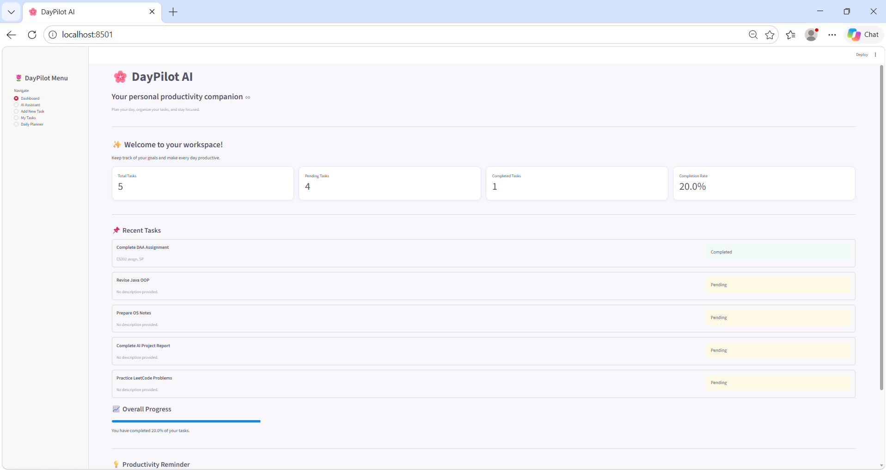
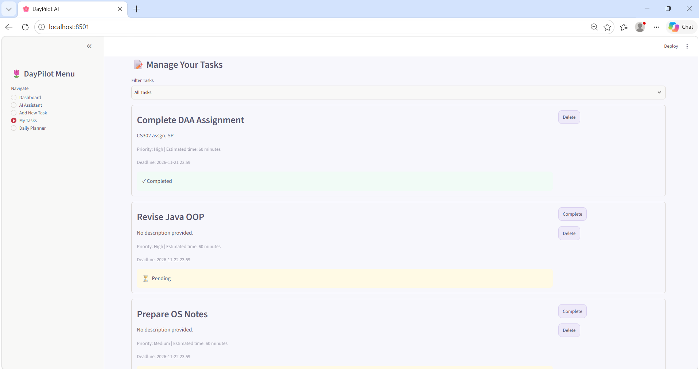
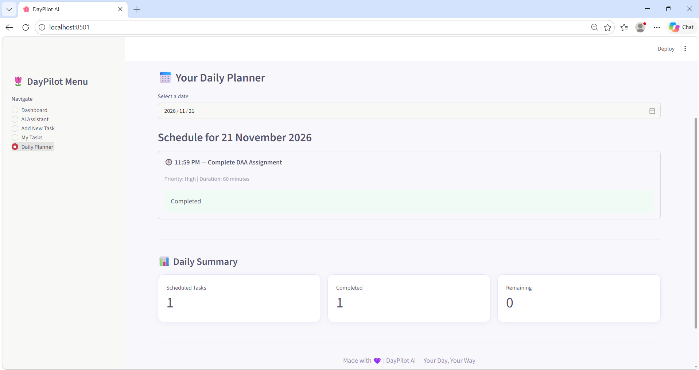
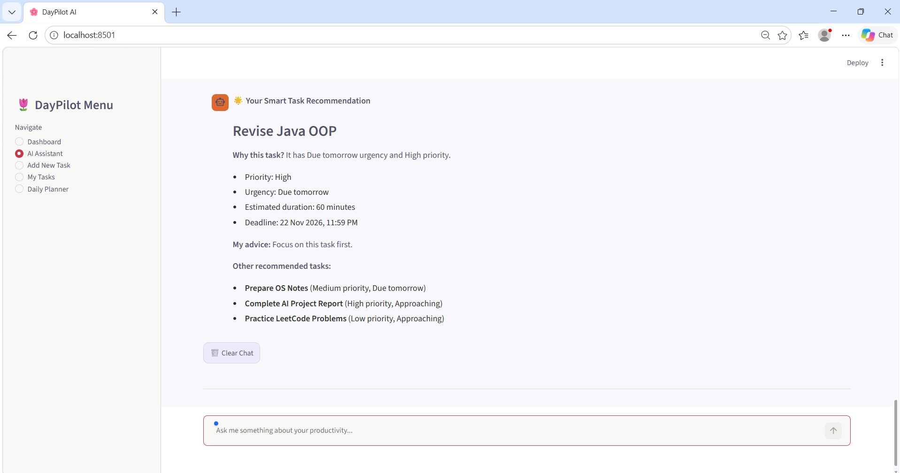
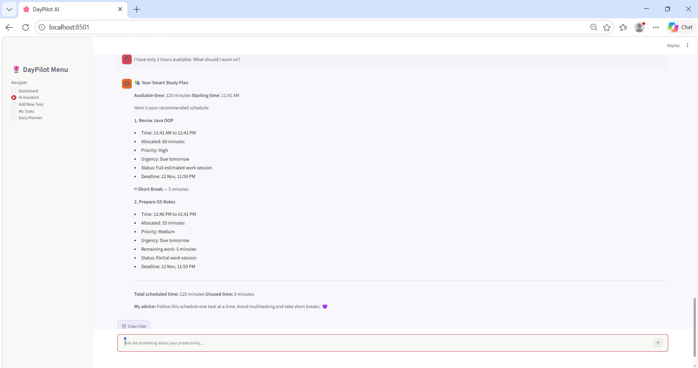

# 🌸 DayPilot AI – Smart Productivity & Task Management Assistant

**Plan Smart. Stay Focused. Get Things Done.**

DayPilot AI is a smart productivity and task management web application developed using Python and Streamlit. It helps users organize daily tasks, manage deadlines, prioritize activities, monitor productivity, and create structured study schedules.

The application features an interactive rule-based AI Assistant that analyzes saved tasks and provides intelligent task recommendations and time-based study plans.

---

## ✨ Key Features

- **Interactive Dashboard:** Displays total tasks, pending tasks, completed tasks, and overall completion rate.
- **Task Management:** Add, view, complete, and delete tasks.
- **Priority Management:** Categorize tasks into High, Medium, and Low priorities.
- **Deadline Tracking:** Monitor approaching deadlines, overdue tasks, and upcoming activities.
- **Daily Planner:** Organize tasks according to their scheduled dates.
- **AI Assistant:** Interact with an assistant to get task-related suggestions and productivity guidance.
- **Smart Task Recommendations:** Identify suitable next tasks based on urgency, priority, and deadlines.
- **Study Plan Generator:** Generate time-based study schedules according to available time and pending tasks.
- **Productivity Report:** Track task completion and overall progress.
- **SQLite Database:** Store task information persistently.

## 🖥️ Application Screenshots

### 1. Dashboard


### 2. My Tasks


### 3. Daily Planner


### 4. AI Assistant


### 5. Generated Study Plan


---

## 🛠️ Technologies Used

- **Python** – Core programming language
- **Streamlit** – Interactive web application framework
- **SQLite** – Database management
- **HTML & CSS** – Interface styling

## 📁 Project Structure

```text
DayPilot-AI/
│
├── app.py
│
├── database/
│   ├── __init__.py
│   └── db.py
│
├── screenshots/
│   ├── dashboard.png
│   ├── my_tasks.png
│   ├── daily_planner.png
│   ├── ai_assistant.png
│   └── study_plan.png
│
├── .gitignore
├── README.md
└── requirements.txt
```

*Note: The SQLite database is generated locally by the application and is excluded from GitHub.*

## ⚙️ Installation and Setup

Follow these steps to run DayPilot AI on your local machine.

### 1. Clone the Repository

```bash
git clone https://github.com/Renesa-Pal-2903/DayPilot-AI.git
```

### 2. Navigate to the Project Directory

```bash
cd DayPilot-AI
```

### 3. Create a Virtual Environment

```bash
python -m venv venv
```

### 4. Activate the Virtual Environment

**Windows:**

```powershell
venv\Scripts\activate
```

### 5. Install Dependencies

```bash
pip install -r requirements.txt
```

### 6. Run the Application

```bash
python -m streamlit run app.py
```

The application will open in your browser at:

```text
http://localhost:8501
```

## 🤖 About the AI Assistant

DayPilot AI includes a rule-based productivity assistant that processes task information stored in the SQLite database.

It provides:

- Task recommendations based on urgency and priority.
- Deadline-related task information.
- Suggestions for the next task to complete.
- Time-based study schedules using available time.
- Pending and completed task summaries.
- Productivity reports.

The assistant uses predefined logic and task data rather than an external generative AI model.

## 🎯 Project Objective

The primary objective of DayPilot AI is to simplify task management and help students and individuals improve productivity through organized scheduling, deadline tracking, priority-based recommendations, and structured daily planning.

## 🚀 Future Scope

- Integration with generative AI models.
- Calendar synchronization and reminders.
- User authentication and personalized profiles.
- Advanced productivity analytics.
- Cloud database integration.

## 👩‍💻 Developer

**Renesa Pal**

GitHub: [Renesa-Pal-2903](https://github.com/Renesa-Pal-2903)

**DayPilot AI – Plan Smart. Stay Focused. Get Things Done.** 🌸